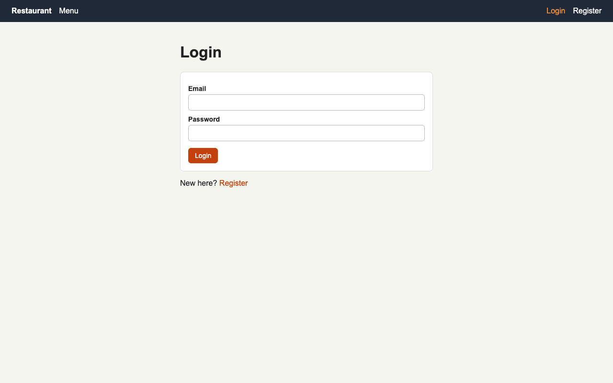
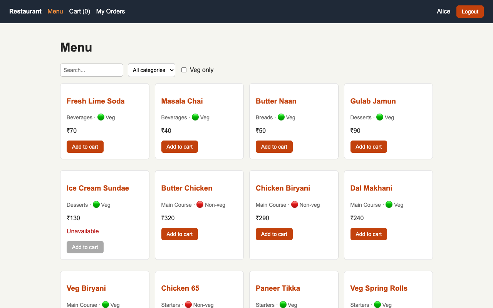
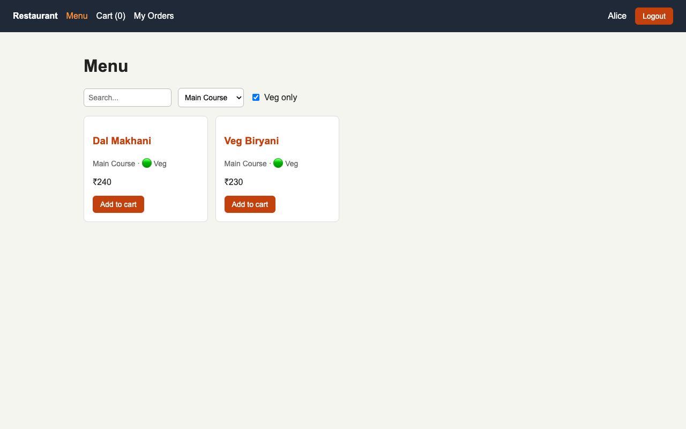
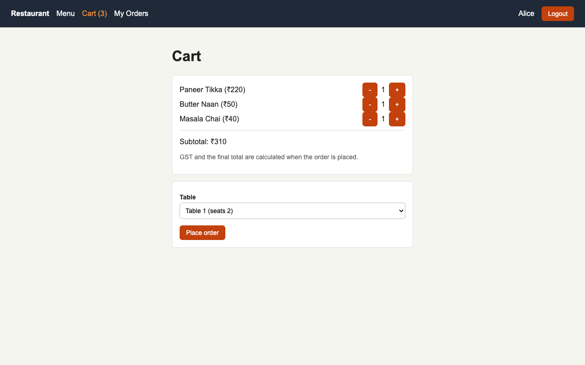
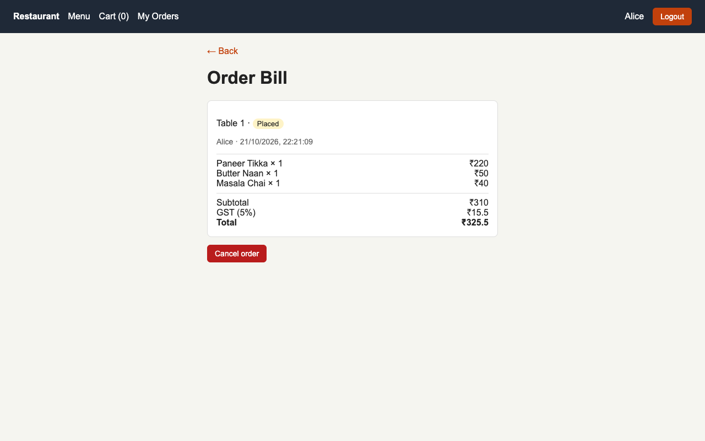
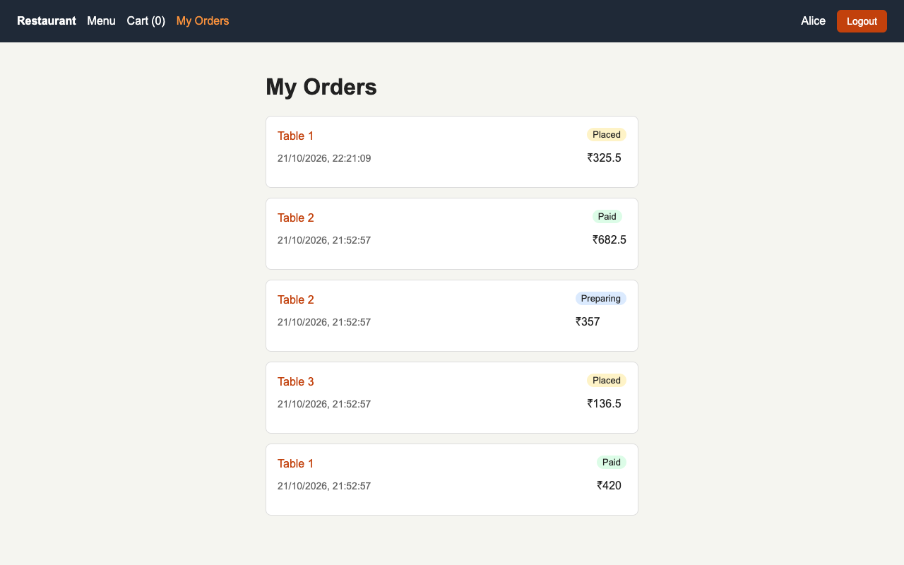
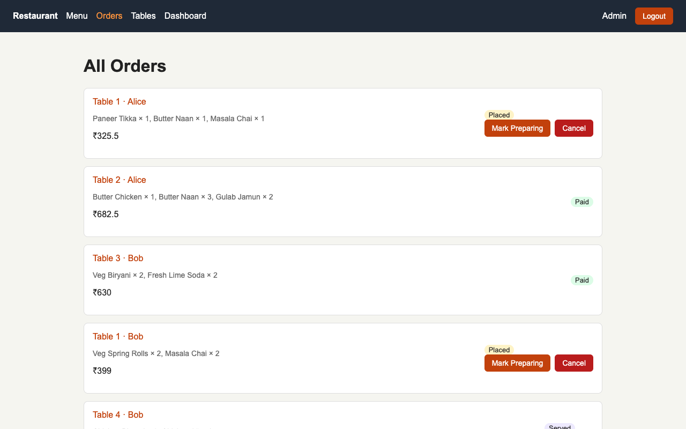
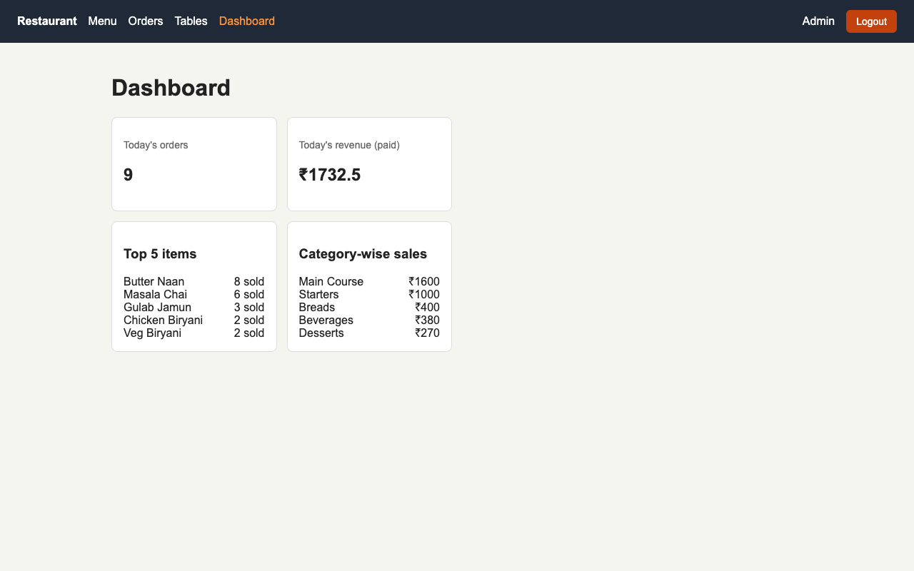
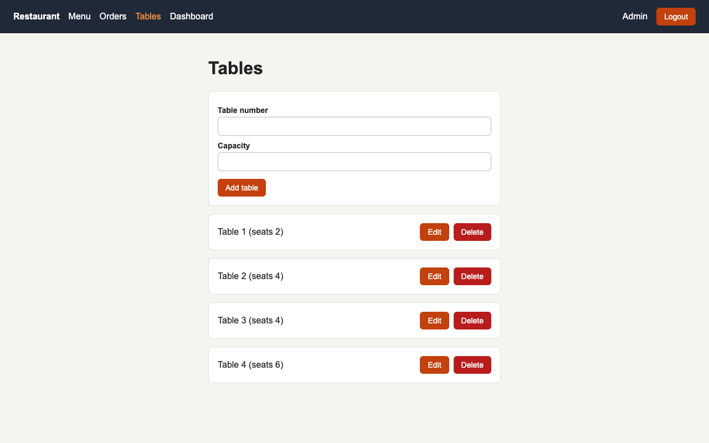
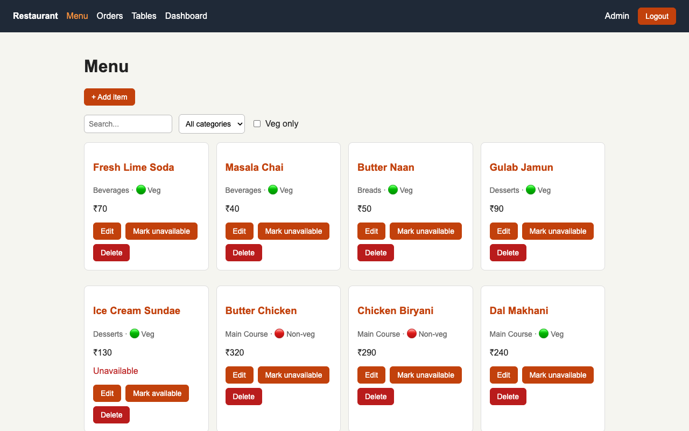

# PS-06: Restaurant Menu & Table Order System

Customers order from a digital menu for their table, and staff (admin) move each order from kitchen to billing.

**Stack:** MongoDB Atlas, Express.js, React (Vite + React Router), Node.js

## Features
- Register / login with roles: `customer` and `admin`
- Admin: menu item CRUD (name, category, price, veg/non-veg, available toggle, image URL) and table CRUD
- Customer: browse menu, search, filter by category, veg-only; cart with quantities (kept in `App.jsx` state + localStorage); place an order for a table
- Unavailable items cannot be ordered; subtotal, 5% GST and total are calculated on the backend
- Status flow: Placed → Preparing → Served → Paid (or Cancelled); customer can cancel only while Placed
- My Orders list and order detail with itemised bill
- Admin dashboard: today's orders, today's revenue, top 5 items, category-wise sales

## Setup
```bash
# Backend
cd Backend
npm install
cp .env.example .env     # fill in MONGO_URI and JWT_SECRET
npm run seed             # sample data
npm start

# Frontend
cd Frontend
npm install
cp .env.example .env     # VITE_API_URL
npm run dev
```

## Environment variables
| Backend | |
|---|---|
| `PORT` | server port (default 5001) |
| `MONGO_URI` | MongoDB Atlas connection string |
| `JWT_SECRET` | secret for signing tokens |
| `CLIENT_URL` | deployed frontend URL for CORS |

| Frontend | |
|---|---|
| `VITE_API_URL` | backend API base, e.g. `http://localhost:5001/api` |

## Test logins (after seeding)
- Admin: `admin@restaurant.com` / `admin123`
- Customer: `alice@example.com` / `customer123`

## API endpoints
| Method | Route | Access |
|---|---|---|
| POST | `/api/auth/register` | public |
| POST | `/api/auth/login` | public |
| GET | `/api/menu`, `/api/menu/:id` | public |
| POST / PUT / DELETE | `/api/menu`, `/api/menu/:id` | admin |
| GET | `/api/tables` | logged in |
| POST / PUT / DELETE | `/api/tables`, `/api/tables/:id` | admin |
| POST | `/api/orders` | customer |
| GET | `/api/orders` | admin |
| GET | `/api/orders/mine` | logged in |
| GET | `/api/orders/:id` | owner or admin |
| PATCH | `/api/orders/:id/status` | admin |
| PATCH | `/api/orders/:id/cancel` | customer (own, Placed only) |
| GET | `/api/dashboard` | admin |

## Pages
`/login`, `/register`, `/menu`, `/menu/:id`, `/cart`, `/my-orders`, `/orders/:id`, `/admin/menu/new`, `/admin/menu/:id/edit`, `/admin/tables`, `/admin/orders`, `/admin/dashboard`

## Deployment
Frontend includes `vercel.json` (SPA rewrite). Set `VITE_API_URL` on the host, and `CLIENT_URL` on the backend.

## Screenshots

| Login | Menu |
|---|---|
|  |  |

| Menu filters (veg + category) | Cart |
|---|---|
|  |  |

| Order bill | My orders |
|---|---|
|  |  |

| Admin orders | Admin dashboard |
|---|---|
|  |  |

| Admin tables | Admin menu |
|---|---|
|  |  |

## Live URL
_Add after deployment._
